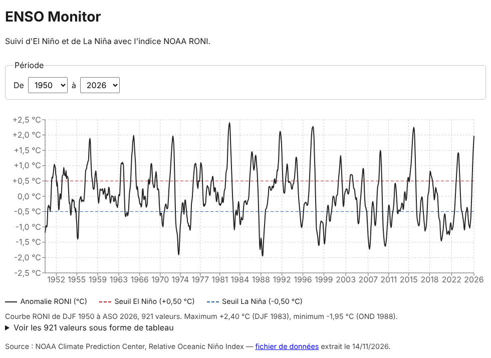

# ENSO Monitor

Plateforme d'exploration de l'indice NOAA **RONI** (Relative Oceanic Niño Index)
pour suivre les épisodes El Niño / La Niña et comparer deux épisodes historiques.

Projet de rattrapage HETIC — RNCP 36146 (BC02 / BC03), réalisé individuellement.
Dossier de conception (PDF) : [docs/ENSO-Monitor-dossier-de-conception.pdf][dossier].

[dossier]: docs/ENSO-Monitor-dossier-de-conception.pdf



## Fonctionnalités
- **Import NOAA** sans doublon et tracé : chaque exécution est enregistrée (`import_run`) ;
  une valeur révisée par la NOAA est mise à jour, une valeur identique est ignorée.
- **Courbe** de l'indice avec unité (°C), seuils ±0,5 °C et source affichée.
- **Filtre de période** avec message d'erreur clair si la période est invalide.
- **Base indisponible** : l'API répond 503 avec un message clair, et le site propose
  « Réessayer » sans recharger la page.
- **Comparaison de deux épisodes** (par défaut 1997-98 et 2015-16) : courbes alignées sur la
  1re saison, pics, durées, et limites de l'interprétation.
- **API documentée** (OpenAPI / Swagger) sous `/api/v1`.
- **Accessibilité** : navigation au clavier, mise en page responsive, tableau des valeurs.

## Données et choix
- Source : NOAA Climate Prediction Center,
  [RONI.ascii.txt](https://www.cpc.ncep.noaa.gov/data/indices/RONI.ascii.txt), extrait le
  14/11/2026 (`backend/data/raw/`, 921 valeurs de DJF 1950 à ASO 2026).
- **RONI plutôt qu'ONI** : indice officiel de la NOAA depuis le 01/02/2026 ; il retire le
  réchauffement de fond de l'océan, ce qui rend la comparaison ancien / récent plus juste.
- Une valeur par saison de 3 mois (DJF, JFM…), datée au 1er jour du **mois central**
  (DJF 1998 → 1998-01-01).
- **Épisode** : au moins 5 saisons consécutives ≥ +0,5 °C (El Niño) ou ≤ −0,5 °C (La Niña).
  Une saison manquante coupe l'épisode ; un épisode qui touche la dernière valeur est « en cours ».
- L'indice mesure l'**intensité et la durée** d'un épisode, pas ses conséquences.
- Lignes invalides du fichier : écartées et signalées, jamais corrigées en silence.

## Stack
- Frontend : React, TypeScript, Vite, Recharts — tests Vitest + Testing Library
- API : Python 3.12, FastAPI, Pydantic
- Données : PostgreSQL 17, SQLAlchemy 2, Alembic
- ETL : Python, Pandas
- Docker Compose, Caddy (porte d'entrée unique)

## Lancement avec Docker (tout en une commande)
```bash
cp .env.example .env                          # puis changer POSTGRES_PASSWORD
docker compose up -d --build                  # base + API (migrations au démarrage) + front
docker compose run --rm etl                   # import des données NOAA
```
Site sur http://localhost:8080 (port `HTTP_PORT`), documentation de l'API sur
http://localhost:8080/docs. Caddy sert le front et transmet `/api/*`, `/docs` et
`/openapi.json` à l'API : une seule adresse, pas de CORS. Date du fichier NOAA importé :
`ETL_EXTRACTED_ON` dans le `.env`. Seul Caddy est exposé ; l'API et la base restent
sur le réseau interne de Docker (la base est aussi ouverte sur `127.0.0.1` pour le dev).
Déploiement sur un VPS (documenté, non réalisé) : [docs/deploiement.md](docs/deploiement.md).

## Lancement local (développement)
```bash
cp .env.example .env
docker compose up -d db                       # PostgreSQL seulement

cd backend
python3.12 -m venv .venv                      # première fois seulement
source .venv/bin/activate
pip install -r requirements.txt               # première fois seulement
alembic upgrade head                          # crée / met à jour les tables
python -m etl --extracted-on 2026-11-14       # importe data/raw/RONI.ascii.txt
uvicorn app.main:app --reload                 # API sur http://localhost:8000
```

Front (dans un second terminal, l'API doit tourner) :
```bash
cd web
npm ci                                        # première fois seulement
npm run dev                                   # http://localhost:5173
```
L'adresse de l'API est `http://localhost:8000` par défaut (modifiable avec `VITE_API_BASE_URL`).

## API
Documentation interactive (OpenAPI) : http://localhost:8000/docs en local,
http://localhost:8080/docs avec Docker.

| Route | Rôle | Erreurs |
|---|---|---|
| `GET /api/v1/observations?start=&end=` | Valeurs d'une période | 422 : date invalide, fin<début |
| `GET /api/v1/episodes?phase=el_nino` (ou `la_nina`) | Épisodes détectés | 422 : phase inconnue |
| `GET /api/v1/health` | L'API répond | — |

Exemple : `/api/v1/observations?start=1997-11-01&end=1998-02-28`. Les deux routes de données
répondent 404 tant qu'aucun import n'a été fait, et 503 « Base de données indisponible » si
PostgreSQL est arrêté (`/api/v1/health` reste à 200 : il ne dépend pas de la base).

## Tests
```bash
cd backend && source .venv/bin/activate
pytest -v                                     # données (ETL) + API

cd web
npm test                                      # front (Vitest)
npx tsc -b                                    # vérification des types TypeScript
npm run lint                                  # lint (échoue au moindre avertissement)
npm run build                                 # build de production dans web/dist
```

| Fichier (`backend/tests/`, `web/src/`) | Ce qui est vérifié |
|---|---|
| `test_transform.py` | Doublons, valeurs contradictoires, lignes invalides, date du mois central |
| `test_load.py` | Réimport sans doublon, valeur révisée par la NOAA mise à jour et tracée |
| `test_api.py` | Filtre par période, période à l'envers, date invalide, aucun import → 404 |
| `test_api_episodes.py` | Épisodes El Niño, phase inconnue → 422 |
| `test_api_database_unavailable.py` | Base injoignable → 503 avec message ; `/health` → 200 |
| `test_episodes.py` | Règle des 5 saisons, saison manquante, épisode en cours, pic La Niña |
| `App.test.tsx` | Changer la période met à jour les valeurs ; erreur 503 puis « Réessayer » |
| `episodeComparison.test.ts` | Texte de comparaison des deux épisodes |
| `chartAxis.test.ts` | Graduations communes aux deux courbes |

Résultat au 22/11/2026 : `pytest` **17 passed**, `npm test` **7 passed** ; `tsc`, lint et build OK.

Les tests d'API et de chargement utilisent une base séparée `enso_test`, créée et remplie
automatiquement (année 1997 du fichier NOAA) : la base de développement n'est jamais modifiée.
Les tests de chargement annulent leur transaction à la fin.

## Structure du dépôt
```
backend/
  app/        API FastAPI : modèles, schémas Pydantic, requêtes, règle des épisodes, routes
  etl/        import NOAA en trois étapes : extract.py, transform.py, load.py
  alembic/    migrations de la base
  data/raw/   fichier NOAA brut (RONI.ascii.txt) et sa source (SOURCE.md)
  tests/      pytest
web/
  src/api/         seul accès réseau du front
  src/hooks/       chargement, erreur, annulation des requêtes
  src/components/  filtre, courbe, tableau, source, comparaison
docs/
  ENSO-Monitor-dossier-de-conception.pdf   dossier de conception
  dossier/         sources du dossier (Markdown, diagrammes, captures)
  deploiement.md   déploiement VPS documenté, sauvegarde / restauration
  usage-ia.md      journal de l'usage de l'IA
  regles-ia.md     règles données à l'assistant IA
compose.yaml       db, api, etl (à la demande), web (Caddy)
```

## Limites connues
- Déploiement **documenté seulement**, pas de mise en ligne réelle.
- Import manuel (`docker compose run --rm etl`), pas planifié.
- La base de test est créée à partir des modèles Python, pas des migrations ;
  `alembic check` vérifie que les deux restent synchronisés.
- Conteneur Caddy en root (image officielle) ; versions d'images Docker non figées par empreinte.
- Un seul fichier JavaScript de 601 kB (Recharts) : avertissement « chunk > 500 kB » au build.

## Usage de l'IA
Outils : **Claude** (claude.ai) pour planifier, expliquer et proposer le code ;
**Claude Code** pour l'intégrer, lancer les vérifications réelles et relire le code.

- **Ce que l'IA a fait** : explications du sujet et des notions techniques, proposition de la
  majeure partie du code, revues de code qui ont trouvé de vrais défauts.
- **Ce que j'ai fait** : les décisions (indice, périmètre, règle des épisodes, arbitrage de chaque
  point de revue), la validation de chaque étape, les vérifications et **tous les commits**.
- **Garde-fous** : règles écrites pour l'assistant ([docs/regles-ia.md](docs/regles-ia.md)) :
  pas de commit par l'IA, pas de donnée ni de résultat inventé, conventions de nommage,
  tests lancés après chaque modification.
- **Erreurs de l'IA détectées et corrigées** : affirmation fausse sur les épisodes, simulation qui
  a laissé un faux import en base, nommage incohérent.
- Journal détaillé, session par session : [docs/usage-ia.md](docs/usage-ia.md).
