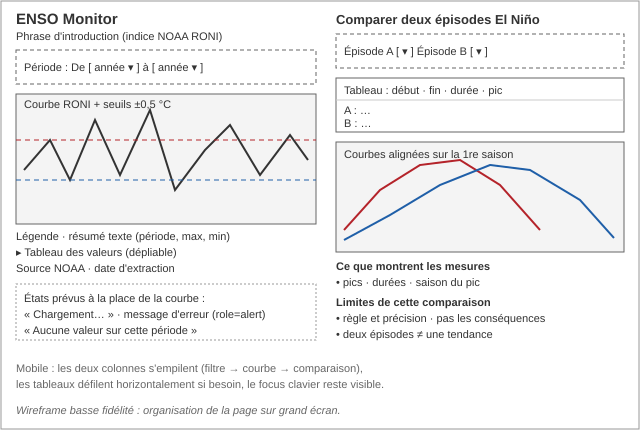
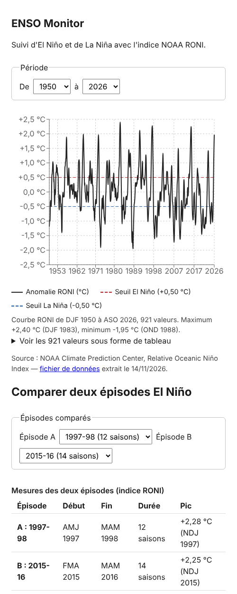
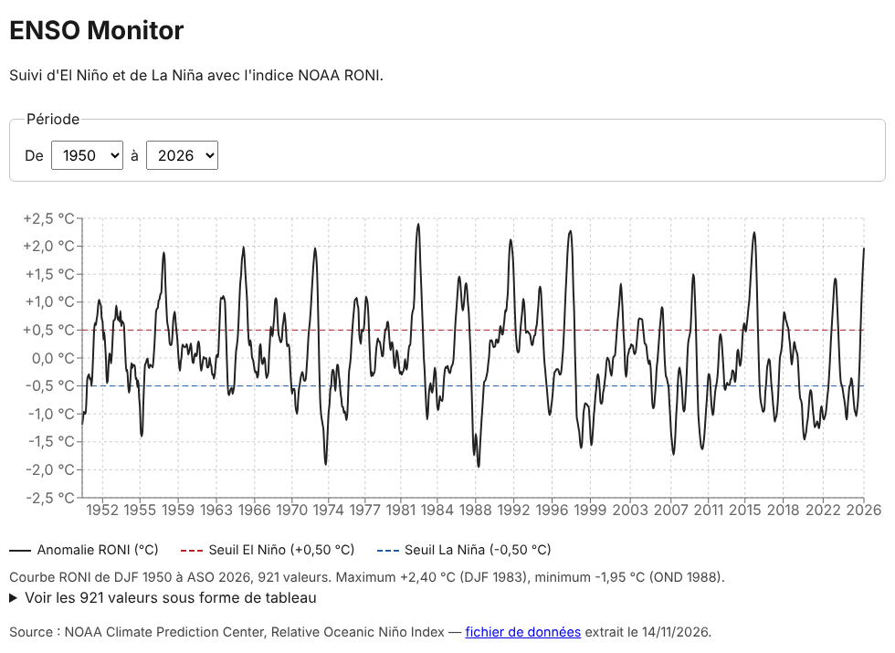
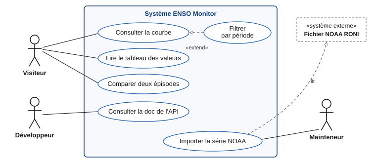
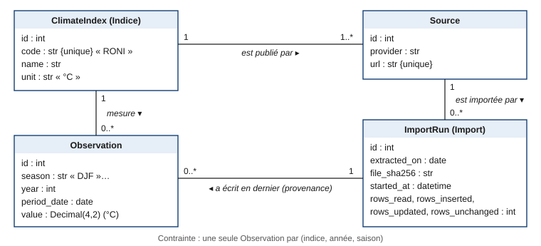
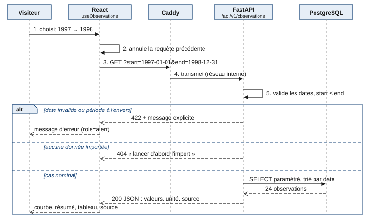
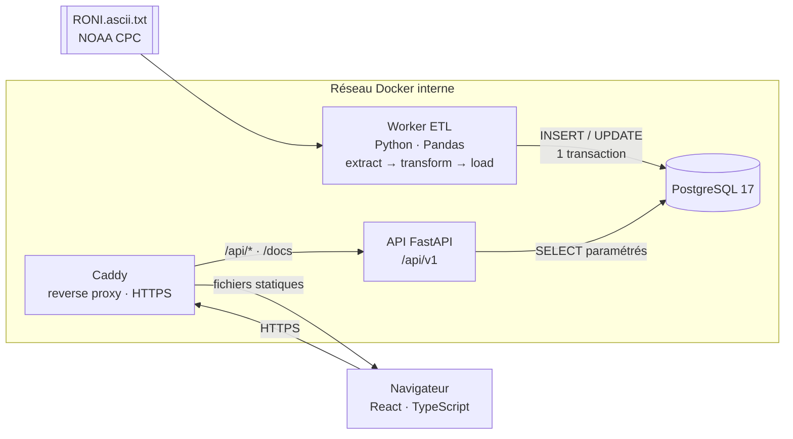
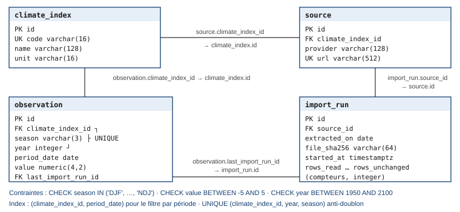
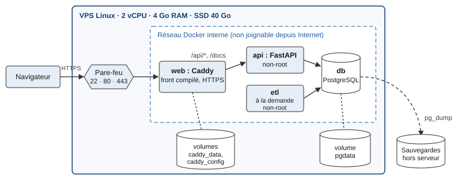

<div class="cover">
<p class="cover-kicker">HETIC · Bachelor Développement Web · Rattrapage RNCP 36146 (BC02, BC03)</p>
<h1 class="cover-title">ENSO Monitor</h1>
<p class="cover-subtitle">Dossier de conception</p>
<p class="cover-lead">Plateforme d'exploration de l'indice NOAA RONI pour suivre les épisodes El Niño et La Niña, et comparer deux épisodes historiques.</p>
<table class="cover-meta">
<tr><th>Auteur</th><td>Alexis Hu</td></tr>
<tr><th>Projet</th><td>Individuel, 5 jours de travail</td></tr>
<tr><th>Rendu</th><td>22 novembre 2026</td></tr>
<tr><th>Code source</th><td>Dépôt Git privé <code>Bagharia/enso-monitor</code> (fourni en ZIP)</td></tr>
<tr><th>Stack</th><td>React · TypeScript · Vite · FastAPI · PostgreSQL · SQLAlchemy · Alembic · Pandas · Docker Compose · Caddy</td></tr>
</table>
<p class="cover-note">Outils d'IA utilisés : Claude (claude.ai) et Claude Code. Leur rôle est détaillé en section 8.</p>
</div>

<div class="toc" style="break-before: page">
<h2 class="no-toc">Sommaire</h2>
<!-- TOC -->
</div>

# 1. Besoin et contexte

## Objectif

ENSO Monitor permet de **consulter la série officielle de l'indice RONI** publiée par la NOAA, de **la filtrer par période**, et de **comparer deux épisodes El Niño** avec une interprétation prudente. Chaque valeur affichée est **traçable** jusqu'au fichier source et à la date d'extraction.

## Contexte scientifique

ENSO (El Niño – Southern Oscillation) désigne l'alternance, dans le Pacifique équatorial, entre des eaux de surface plus chaudes (**El Niño**) ou plus froides (**La Niña**) que la normale. On la suit avec un indice calculé sur la zone **Niño 3.4**, par saisons de 3 mois glissants (DJF, JFM…).

| | ONI (historique) | RONI (retenu) |
|---|---|---|
| Référence | Moyenne de la zone Niño 3.4 sur 30 ans | Anomalie Niño 3.4 **moins** l'anomalie moyenne des tropiques (20°S–20°N), remise à la même variabilité |
| Statut NOAA | Indice historique, toujours publié | **Indice officiel depuis le 1er février 2026** |
| Effet | Le réchauffement de fond peut gonfler les El Niño récents | Le réchauffement de fond est retiré : un épisode de 1950 et un de 2025 se comparent à égalité |

Les règles de lecture sont les mêmes pour les deux : **≥ +0,5 °C** (El Niño) ou **≤ −0,5 °C** (La Niña) pendant **au moins 5 saisons consécutives**.

## Public cible et contraintes

- **Public** : non spécialiste mais exigeant (étudiants, enseignants, curieux du climat), qui veut lire une tendance sans manipuler de fichier brut.
- **Contraintes** : projet individuel en 5 jours ; stack imposée ; **données NOAA authentiques** et sourcées ; graphiques accessibles ; aucun coût d'hébergement ; usage de l'IA autorisé mais déclaré.

## Périmètre du MVP et limites

- **Dans le périmètre** : import NOAA tracé et sans doublon, API documentée et versionnée, courbe filtrable, tableau accessible, comparaison de deux épisodes, 3 tests minimaux (au final 24), déploiement documenté et vérifié en local avec Docker.
- **Hors périmètre (choisi)** : espace d'administration, export, carte ERA5, prévisions, autres indices.
- **Limites du sujet** : un indice mesure **l'intensité et la durée** d'une anomalie de température, **pas ses conséquences** (pluies, sécheresses, dégâts). L'application ne fait aucune prévision.

## Choix déterminant : l'indice

| Besoin | Solutions envisagées | Choix | Avantages | Limites | Vérification |
|---|---|---|---|---|---|
| Comparer honnêtement des épisodes anciens et récents | ONI, RONI | **RONI** | Standard officiel actuel ; retire le réchauffement de fond | Indice récent, moins de littérature ; atténue souvent les El Niño par rapport à l'ONI | Source NOAA citée ; valeurs de l'application contrôlées contre le fichier |

# 2. Fonctionnel et UX

## User stories, priorisation et critères d'acceptation

La priorisation suit **MoSCoW** : le délai est fixe et le sujet distingue déjà un MVP obligatoire (*Must*) de fonctionnalités facultatives (*Could*). Des méthodes chiffrées comme RICE ont été écartées : sans utilisateurs ni données d'usage, leurs scores auraient été inventés.

| # | User story | Priorité | Critère d'acceptation | État |
|---|---|---|---|---|
| US1 | En tant que mainteneur, j'importe le fichier RONI de la NOAA dans PostgreSQL | Must | Relancer l'import ne crée aucun doublon ; chaque valeur garde sa source (URL, date d'extraction, empreinte du fichier) | ✅ |
| US2 | En tant que visiteur, je vois la courbe RONI dans le temps | Must | Unité (°C) et source visibles sur la page | ✅ |
| US3 | En tant que visiteur, je choisis une période et la courbe se met à jour | Must | Période incohérente impossible à saisir ; erreur d'API affichée clairement | ✅ |
| US4 | En tant que visiteur, je compare deux épisodes historiques | Must | Épisodes côte à côte, interprétation **et** limites affichées | ✅ |
| US5 | En tant que développeur, j'interroge une API documentée | Must | `GET /api/v1/observations?start=&end=` dans OpenAPI ; entrée invalide → 422 | ✅ |
| US6 | En tant que visiteur, j'utilise le site au clavier et sur mobile | Must | Navigation clavier, mise en page fluide, tableau des valeurs | ✅ |
| US7 | Phases colorées (El Niño / La Niña / neutre) | Could | Règle des 5 saisons respectée | Partiel : la détection existe (US4), pas la coloration |
| US8 | Administration, export, carte ERA5, prévisions | Won't | Hors périmètre assumé | — |

## Parcours utilisateurs

1. **Explorer une période** : le visiteur choisit « de 1997 à 1998 » → la courbe, le résumé texte et le tableau se mettent à jour. La liste « à » ne propose que des années postérieures au début : **l'erreur est rendue impossible** plutôt que signalée.
2. **Comparer deux épisodes** : 1997-98 et 2015-16 sont proposés par défaut (deux El Niño forts à 18 ans d'écart) ; le visiteur peut en choisir d'autres parmi les 22 épisodes détectés.
3. **Parcours d'erreur** : si l'API ou la base ne répondent pas, un message explicite (« Base de données indisponible… ») remplace la courbe, annoncé aux lecteurs d'écran (`role="alert"`), avec un bouton **Réessayer** qui relance la même demande.

## Wireframe et maquette finale

<figure class="figure-row">


<figcaption>À gauche, le wireframe : filtre, courbe et ses états, comparaison. À droite, l'application réelle sur un écran étroit (500 px) : les blocs s'empilent.</figcaption>
</figure>

<figure>

<figcaption>Écran principal : filtre de période, courbe RONI de 1950 à 2026 avec les seuils ±0,5 °C, légende, résumé textuel, tableau dépliable et source.</figcaption>
</figure>

# 3. UML et modélisation

## Diagramme de cas d'utilisation

<figure></figure>

**Lecture** : trois acteurs humains. Le **visiteur** lit et compare, le **développeur** consulte la documentation OpenAPI (`/docs`), le **mainteneur** lance l'import. Le fichier NOAA est un système externe, lu uniquement par l'import. Il n'y a **pas d'administrateur** : aucune donnée n'est modifiable depuis l'interface, ce qui supprime toute une classe de risques (authentification, droits).

## Diagramme de classes (modèle de domaine)

<figure></figure>

**Justification des cardinalités.**

- **Indice 1 — 1..\* Source** : RONI vient aujourd'hui d'un seul fichier, mais un même indice peut être publié à plusieurs adresses ; une source sert toujours un seul indice.
- **Source 1 — 0..\* Import** : on réimporte la même URL à chaque nouvelle publication ; chaque exécution est une ligne, ce qui constitue l'historique.
- **Indice 1 — 0..\* Observation** : 921 valeurs pour RONI (DJF 1950 → ASO 2026), **une seule par couple (année, saison)**.
- **Import 1 — 0..\* Observation** : chaque observation pointe vers l'import qui l'a écrite ou modifiée en dernier (`last_import_run_id`) : c'est la **provenance** de chaque valeur.

## Diagramme de séquence : consulter le graphique

<figure></figure>

**Points clés** : les réponses repassent par Caddy (simplifié ici) ; la validation se fait **avant** toute requête SQL ; les dates sont envoyées **séparément** du texte SQL (pas d'injection possible) ; si la période change avant la réponse, l'ancienne requête est annulée et une réponse tardive ne peut pas écraser la plus récente.

# 4. Architecture technique

## Architecture logique



| Composant | Responsabilité | Échanges |
|---|---|---|
| **ETL** (`backend/etl/`) | `extract.py` lit le fichier tel quel ; `transform.py` valide, dédoublonne et date (fonctions pures) ; `load.py` écrit en base et trace l'import | Lit le fichier, écrit dans PostgreSQL, puis s'arrête |
| **API** (`backend/app/`) | Routes `observations` et `episodes`, schémas Pydantic, requêtes partagées (`queries.py`), règle des épisodes (`episodes.py`, fonctions pures) | Lit PostgreSQL, répond en JSON |
| **Front** (`web/src/`) | `api/` (seul accès réseau), `hooks/` (états chargement / erreur / succès), `components/` (affichage), fonctions pures de comparaison et d'axes | Appelle `/api/v1/...` sur sa propre adresse |
| **Caddy** | Point d'entrée unique : fichiers du front, transmission de `/api/*` et `/docs`, HTTPS, en-têtes de sécurité | Seul service exposé |

## Décisions d'architecture

| Décision | Alternatives | Pourquoi | Limite assumée |
|---|---|---|---|
| **PostgreSQL** | SQLite, fichiers CSV | Contraintes d'intégrité (`UNIQUE`, `CHECK`, clés étrangères), transactions, standard serveur | Un service de plus à exploiter |
| **ETL séparé de l'API** | Import au démarrage de l'API, à la demande d'un visiteur | L'import est occasionnel, l'API répond à chaque visite : un fichier cassé ou le réseau NOAA ne peuvent pas faire tomber le site | Import manuel, pas planifié |
| **Import idempotent (upsert)** | Tout effacer puis réinsérer ; ignorer les existantes | Nouvelle valeur insérée, valeur révisée par la NOAA mise à jour, identique ignorée ; une seule transaction | Une saison contradictoire déjà en base garde l'ancienne valeur (signalé) |
| **API versionnée `/api/v1`** | Routes sans version | Faire évoluer le format en `/v2` sans casser les clients existants | Version unique pour l'instant |
| **Même origine via Caddy** | Front et API sur deux ports + CORS | Pas de CORS en production, un seul point d'entrée exposé | CORS conservé pour le développement avec Vite |
| **Monorepo** | Un dépôt par couche | Projet solo, un seul historique, un seul ZIP | Couches moins isolées (dossiers séparés) |
| **Recharts + tableau** | Chart.js, D3 | Composants React déclaratifs, lisibles en revue de code | SVG non lisible par un lecteur d'écran → résumé texte et tableau |

## Schéma relationnel

<figure></figure>

- **Intégrité** : `uq_observation_climate_index_year_season` (anti-doublon garanti par la base, même si le code Python a un bug) ; `ck_observation_season` (12 saisons autorisées) ; `ck_observation_value_range` (−5 à +5 °C) ; `ck_observation_year_range`.
- **Index utile** : `ix_observation_climate_index_period (climate_index_id, period_date)`, aligné sur le filtre par période de l'API.
- **Types** : `numeric(4,2)` et `Decimal` en Python : 2,13 reste exactement 2,13, ce qui évite de fausses « révisions » lors des comparaisons.
- **Dates** : chaque saison est placée au 1er jour de son **mois central** (DJF 1998 → 1998-01-01 ; NDJ 1997 → 1997-12-01).
- **Migrations** : Alembic, versionnées dans Git ; `alembic check` confirme que modèles et base sont synchronisés.
- **Provenance** : `import_run` garde la date d'extraction et l'empreinte SHA-256 du fichier ; `last_import_run_id` relie chaque valeur à son import.

# 5. Organisation du projet

## Planning sur cinq jours : prévu et réel

| Jour | Prévu | Réalisé (d'après l'historique Git) | Écart et arbitrage |
|---|---|---|---|
| J1 · sam. 14/11 | Cadrage, backlog, dépôt, PostgreSQL, données | Sujet analysé, choix RONI, backlog MoSCoW, dépôt et PostgreSQL Docker (`4e98e09`), données NOAA sourcées (`a89c87e`) | Conforme |
| J2 · lun. 16/11 | Modèle de données + ETL + test | Modèle et migration (`63989e7`), ETL complet (`697d36a`, `5abc0d1`), correction de l'ETL (`da4bc9d`), **API et ses tests** (`44b2c49`, `d1ad09d`), puis **front React** vérifié dans le navigateur en fin de soirée | Avance prise sur J3 |
| J3 · mar. 17/11 | API + front | Comparaison des épisodes (US4) : route `episodes` et section de comparaison | Front et US4 commités ensemble le 18/11 à 0 h 51 (`be6949d`, `45c6210`) : front resté une journée hors de Git, risque relevé en revue |
| J4 · mer. 18 – jeu. 19/11 | Comparaison, Docker | Revue de nommage (`a6f307b`), Docker Compose + Caddy vérifiés en local (`ff23b1b`), axes factorisés (`3b9a67f`) | Docker retardé par un blocage du démon Docker local |
| J5 · ven. 20/11 | Dossier, préparation de l'oral | Dossier de conception, simulation d'oral ; le 22/11, base indisponible gérée (503 + Réessayer) et tests du chargement | Points faibles repérés en relisant le projet, corrigés avant le rendu |

## Outils et suivi

- **Git / GitHub** (dépôt privé), commits conventionnels (`feat`, `fix`, `refactor`, `test`, `docs`), en anglais depuis J2 : les deux premiers commits en français n'ont pas été réécrits, car l'historique publié ne se modifie pas.
- **Docker Desktop (OrbStack)**, **VS Code**, **pytest**, **Vitest**, **oxlint** (avertissements bloquants), **TypeScript strict**.
- **IA** : Claude (claude.ai) pour planifier, expliquer et proposer le code ; Claude Code pour l'intégrer et le vérifier sur la machine. Ses règles sont écrites dans `CLAUDE.md` (copie consultable : `docs/regles-ia.md`) : conventions, interdiction de commit, interdiction d'inventer des données. Chaque session est journalisée dans `docs/usage-ia.md`.
- **Suivi** : à chaque étape, revue de code par Claude Code → décision → correction → vérification réelle (tests, `curl`, captures) → commit.

## Risques et arbitrages

| Risque rencontré | Impact | Réponse |
|---|---|---|
| Retard au démarrage (J1–J2) | Planning tendu | Backlog réduit aux *Must* ; US7 laissée en *Could* |
| Transformation qui corrigeait des données en silence (1998.5 → 1998) | Donnée fausse en base sans alerte | Corrigé, prouvé par un test qui échoue sans le correctif (`da4bc9d`) |
| Faux import laissé en base par une simulation | Traçabilité faussée | Base recréée ; tests d'API déplacés sur une base de test séparée |
| Démon Docker bloqué au téléchargement d'images | Étape Docker retardée | Vérification de repli, puis relance réussie après redémarrage |
| Commentaire affirmant un fait faux (« les deux El Niño les plus forts ») | Crédibilité à l'oral | Corrigé : 1982-83 a un pic plus élevé (+2,40 °C) |

# 6. Qualité et sécurité

## Stratégie de tests

| Niveau | Fichier | Ce qui est vérifié | Nombre |
|---|---|---|---|
| Données (exigé) | `tests/test_transform.py` | Doublons, lignes invalides, valeurs contradictoires écartées, date du mois central | 3 |
| Règle métier | `tests/test_episodes.py` | 5 saisons minimum, saison manquante qui coupe un épisode, épisode en cours, pic La Niña | 5 |
| Chargement | `tests/test_load.py` | Insertion, réimport sans doublon, valeur révisée mise à jour et tracée | 2 |
| API (exigé) | `tests/test_api.py`, `test_api_episodes.py` | Période valide → 200 ; à l'envers ou date invalide → 422 ; indice sans import → 404 ; phase inconnue → 422 | 6 |
| API (panne) | `test_api_database_unavailable.py` | Base injoignable → 503 avec message ; `/health` reste à 200 | 1 |
| Front (exigé) | `App.test.tsx` | Changer la période rappelle l'API et met à jour les valeurs ; erreur affichée puis « Réessayer » | 2 |
| Front (logique) | `episodeComparison.test.ts`, `chartAxis.test.ts` | Texte d'interprétation, graduations de l'axe | 5 |

**Total : 17 tests Python et 7 tests front, tous verts.** Les tests d'API tournent sur une **base séparée** (`enso_test`) remplie avec les **vraies valeurs NOAA de 1997** ; la base de développement n'est jamais touchée. Pour les corrections, on a vérifié que **le test échoue quand on retire le correctif**, puis passe quand on le remet.

## Vérifications UX et accessibilité

Navigation entièrement au clavier (focus toujours visible) ; courbe masquée aux lecteurs d'écran (`aria-hidden`), remplacée par un **résumé textuel** (période, nombre de valeurs, maximum, minimum) et un **tableau** des valeurs ; changements d'état annoncés (`aria-live`) ; affichage vérifié de 375 px (mode responsive de Chrome) à 1 280 px ; nombres et dates au format français.

## Sécurité

- **Entrées** : validation Pydantic (types, `start ≤ end`, phase autorisée) ; **requêtes SQL paramétrées** par SQLAlchemy.
- **Secrets** : `.env` hors de Git, `.env.example` sans vrai mot de passe ; le front ne contient aucun secret.
- **Surface d'exposition** : seul Caddy est exposé ; API et base restent sur le réseau Docker interne ; CORS limité à `GET` et aux origines listées ; API et ETL sans les droits root.
- **En-têtes** : `X-Frame-Options`, `X-Content-Type-Options`, `Referrer-Policy`, `Strict-Transport-Security`.

## Performance

Volume faible (921 lignes) : une requête indexée par période. L'import charge l'existant **en une seule requête** au lieu de 921. Le JavaScript compilé pèse environ 600 ko (176 ko compressés), à cause de Recharts : limite connue, réductible par découpage du code.

## Traitement des anomalies

| Anomalie | Comportement | Où |
|---|---|---|
| Ligne illisible, saison inconnue, année non entière, plus de 2 décimales, valeur hors plage | Écartée **et signalée**, jamais corrigée en silence | `transform.py` |
| Deux valeurs différentes pour une même saison | Saison écartée, les deux valeurs citées dans le message | `transform.py` |
| Doublon identique | Un seul gardé, signalé | `transform.py` |
| Valeur révisée par la NOAA | Mise à jour, import tracé | `load.py` |
| Erreur pendant l'import | Transaction annulée : base inchangée | `etl/__main__.py` |
| Demande invalide / aucune donnée | 422 / 404 avec un message explicite (jamais de 500) | API |
| Base arrêtée ou injoignable | 503 « Base de données indisponible », sans détail technique ; bouton « Réessayer » | API + front |

# 7. Déploiement proposé

> Déploiement **documenté et vérifié en local avec Docker**, sans mise en ligne réelle (facultative selon le sujet).

<figure></figure>

## Hébergement et dimensionnement

Un **VPS Linux** chez un hébergeur européen (Hetzner, par exemple), sans achat dans le cadre du projet. **2 vCPU, 4 Go de RAM et 40 Go de SSD** suffisent largement : 921 lignes, une API sans calcul lourd, et des images Docker légères (Python slim, Alpine). La marge sert aux builds Docker, qui consomment plus que l'exécution. Un seul serveur reste **un point de défaillance unique**, ce qui est acceptable pour ce service de consultation.

## Conteneurs, réseau et volumes

| Service | Image | Rôle | Exposé |
|---|---|---|---|
| `db` | `postgres:17-alpine` | Données, volume `pgdata` | Non (port à retirer sur le VPS) |
| `api` | `enso-monitor-backend` | Migrations au démarrage, puis API ; contrôle de santé `/api/v1/health` | Non |
| `etl` | `enso-monitor-backend` (même image) | Profil `tools`, lancé à la demande | Non |
| `web` | Build Node → `caddy:2-alpine` | Front compilé + reverse proxy | Oui : 80 / 443 |

Démarrage ordonné par contrôles de santé : `db` *healthy* → `api` *healthy* → `web` et `etl`.

```caddyfile
{$SITE_ADDRESS::80} {
	encode gzip
	@api path /api/* /docs* /openapi.json
	handle @api {
		reverse_proxy api:8000
	}
	handle {
		root * /srv
		try_files {path} /index.html
		file_server
	}
	header Strict-Transport-Security "max-age=31536000"
}
```
<p class="caption">Extrait du Caddyfile (en-têtes secondaires omis) : avec un nom de domaine dans <code>SITE_ADDRESS</code>, Caddy obtient et renouvelle seul le certificat HTTPS.</p>

## Configuration et sécurité du serveur

Variables dans `.env` (jamais commité) : `POSTGRES_*` avec un mot de passe long et aléatoire, `SITE_ADDRESS`, `HTTP_PORT=80`, `HTTPS_PORT=443`, `ETL_EXTRACTED_ON`. Accès **SSH par clé uniquement** (mot de passe désactivé) ; pare-feu limité aux ports 22, 80 et 443 ; mises à jour de sécurité automatiques du système à activer.

## Exploitation

| Besoin | Procédure |
|---|---|
| Mise en production | `git clone`, `.env`, `docker compose up -d --build`, `docker compose run --rm etl` |
| Mise à jour | `git pull` puis `docker compose up -d --build` (migrations appliquées au démarrage de l'API) |
| Sauvegarde | `docker compose exec -T db sh -c 'pg_dump --clean --if-exists -U "$POSTGRES_USER" "$POSTGRES_DB"' > sauvegarde.sql`, chaque nuit, copie conservée hors du serveur |
| Restauration | `docker compose exec -T db sh -c 'psql -v ON_ERROR_STOP=1 -U "$POSTGRES_USER" "$POSTGRES_DB"' < sauvegarde.sql` (testée sur une base temporaire) |
| Journaux / supervision | `docker compose logs -f api`, `docker compose ps` (états *healthy*), surveillance externe de `/api/v1/health` |
| Retour arrière | `git checkout <version précédente>` puis `up -d --build` ; restauration de la sauvegarde si une migration a modifié les données |
| Panne | Base arrêtée : l'API répond 503 et le site propose « Réessayer » ; ajouter `restart: unless-stopped` sur le VPS ; serveur perdu : nouveau VPS + dépôt + dernière sauvegarde |

**Limites** : migrations au démarrage (à revoir avec plusieurs instances de l'API) ; conteneur Caddy en root (image officielle, ports 80/443) ; versions d'images non figées par empreinte ; pas d'intégration continue ; Swagger charge ses scripts depuis un CDN.

# 8. Bilan et sources

## Choix justifiés

RONI plutôt qu'ONI pour comparer à égalité des épisodes éloignés dans le temps ; ETL séparé et idempotent pour la traçabilité ; contraintes d'intégrité en base en plus des contrôles Python ; une interprétation **calculée à partir des données** et toujours accompagnée de ses limites ; Caddy comme point d'entrée unique.

**Résultat de la comparaison 1997-98 / 2015-16** (règle : ≥ +0,5 °C pendant au moins 5 saisons, valeurs à 2 décimales) : pics comparables (+2,28 °C et +2,25 °C, tous deux en NDJ) ; 12 saisons contre 14. **Avec des valeurs arrondies au dixième, les durées deviennent 13 et 18 saisons** : la durée d'un épisode dépend de la précision retenue, et l'application le dit.

## Apports de l'IA

- **Ce que l'IA a fait** : Claude a servi de tuteur (explication du sujet, d'ONI/RONI et de chaque notion technique, questions de vérification après chaque étape) et a **proposé la majeure partie du code**. Claude Code l'a intégré sur ma machine, a lancé les vérifications réelles et a fait des **revues de code** qui ont trouvé de vrais défauts.
- **Ce que j'ai fait** : les décisions (indice, périmètre, épisodes, arbitrages des revues), la validation de chaque étape, les commits, les vérifications dans le navigateur, et le travail de compréhension pour pouvoir défendre chaque ligne.
- **Garde-fous** : `CLAUDE.md` (pas de commit par l'IA, pas de données inventées, conventions de nommage) et un journal `docs/usage-ia.md`.
- **Limites constatées** : l'IA s'est trompée plusieurs fois (affirmation fausse sur les épisodes, simulation qui a pollué la base, nommage incohérent). Chaque erreur a été détectée par une vérification ou une revue, puis corrigée.

## Difficultés et corrections

- **Comprendre le sujet lui-même.** C'était ma plus grosse difficulté : pourquoi RONI plutôt qu'ONI, ce que représentent les saisons DJF, JFM…, et pourquoi la règle des 5 saisons consécutives. Je ne pouvais pas faire de bons choix techniques sans comprendre ce que mesurent les données. J'ai d'abord reformulé le sujet avec mes mots, avec des images simples (un élève qui a de la fièvre dans une classe trop chauffée pour RONI), avant de coder.
- **Les notions du back et de l'architecture.** Plusieurs notions étaient nouvelles pour moi : pourquoi des migrations Alembic (la *structure* de la base, versionnée) alors que l'ETL remplit les *données* ; pourquoi le front ne parle jamais directement à la base mais passe par l'API ; la transaction « tout ou rien » et l'idempotence de l'import. Je les ai travaillées avec des exemples concrets (des étagères et des produits, un restaurant où le client ne rentre pas en cuisine, un virement bancaire), puis vérifiées sur les résultats réels.
- **Expliquer avec mes mots.** En QCM, je reconnaissais la bonne réponse ; à l'oral, j'avais du mal à la justifier. J'ai remplacé les QCM par des questions ouvertes après chaque étape, en reformulant jusqu'à pouvoir donner la raison de chaque choix.
- **Encadrer l'IA.** Les propositions et les revues de Claude Code arrivaient vite et en nombre : le risque était de tout accepter sans comprendre. J'ai écrit des règles (`CLAUDE.md` : pas de commit par l'IA, pas de données inventées), tranché chaque point de revue un par un, et écarté un message de commit qui annonçait des tests pas encore écrits.

Corrections notables : données corrigées en silence (section 5), erreur 500 devenue 404 avec un test (section 6), un même nom (`MAX_YEAR`) pour deux concepts différents, Swagger inaccessible derrière Caddy (route `/docs` ajoutée au Caddyfile).

## Sources

- NOAA CPC, *Relative Oceanic Niño Index (RONI)* et *Oceanic Niño Index (ONI)* : cpc.ncep.noaa.gov/products/analysis_monitoring/enso/ ; données : cpc.ncep.noaa.gov/data/indices/RONI.ascii.txt (extraites le 14/11/2026).
- National Weather Service, *Public Information Statement 26-05 : Implementing a Relative Oceanic Niño Index effective February 1, 2026* : weather.gov/media/notification/pdf_2026/pns26-05_Relative_ONI.pdf
- National Weather Service, *Relative Oceanic Niño Index (RONI) – Information Circular* : weather.gov/media/climateservices/RONI.pdf
- NIDIS / Drought.gov, *New NOAA El Niño-Southern Oscillation Index Supports Drought Early Warning* (11/03/2026).
- France compétences, RNCP 36146 ; documentations FastAPI, SQLAlchemy, Alembic, Docker Compose, Caddy ; W3C, *WCAG 2.2*.
